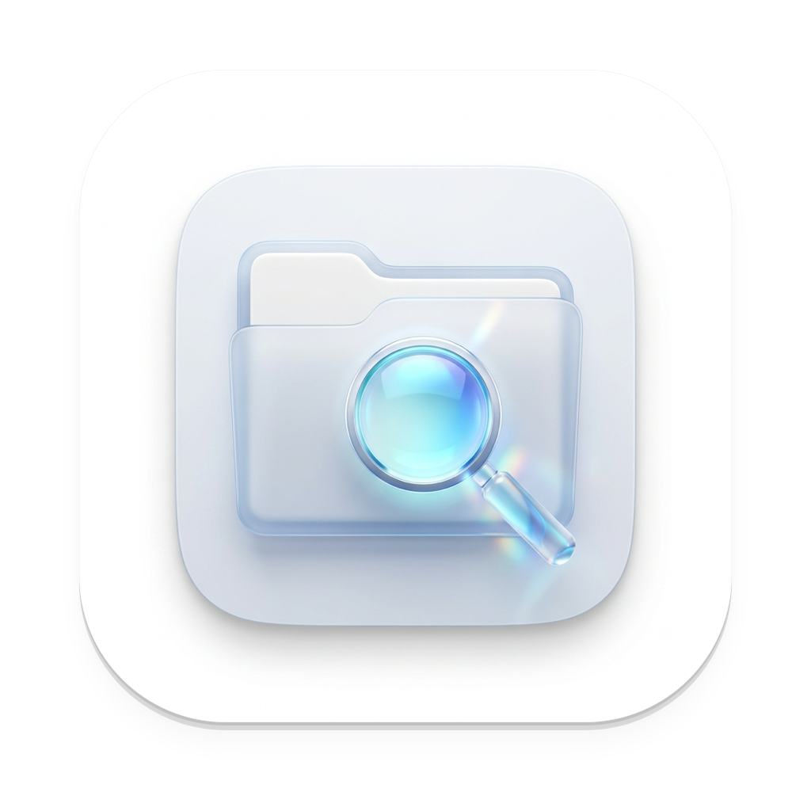
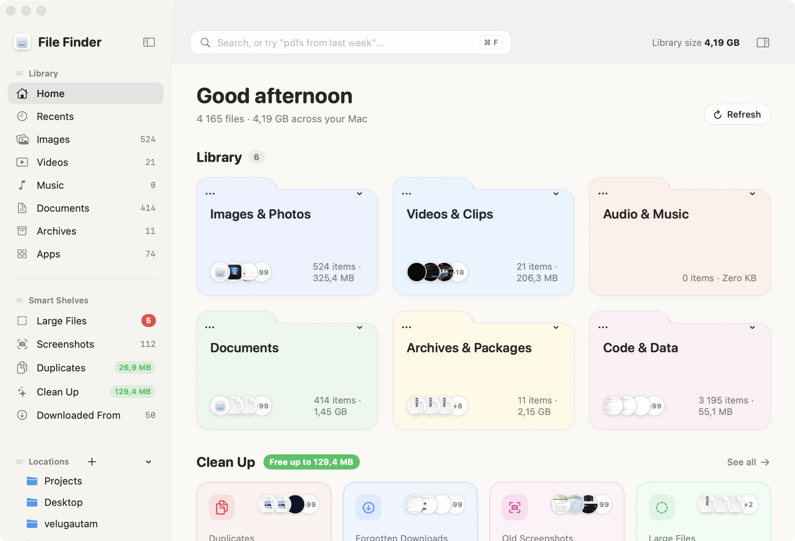
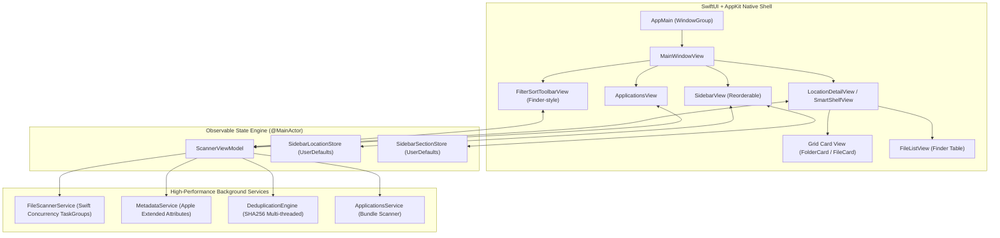

<p align="center">
  
</p>

<h1 align="center">File Finder</h1>

<p align="center">A blazing-fast, Scandinavian minimalist file manager and smart shelf assistant for macOS.</p>

<p align="center">
  <a href="https://github.com/velusgautam/file-finder/releases/latest"></a>
  <a href="https://github.com/velusgautam/file-finder/releases"></a>
  <a href="https://github.com/velusgautam/file-finder/actions/workflows/ci.yml"></a>
  
  
  <a href="LICENSE"></a>
</p>

<p align="center">
  <a href="#about">About</a> ·
  <a href="#download">Download</a> ·
  <a href="#features">Features</a> ·
  <a href="#architecture">Architecture</a> ·
  <a href="#build-from-source">Build from source</a> ·
  <a href="#keyboard-shortcuts">Shortcuts</a> ·
  <a href="https://github.com/velusgautam/file-finder/releases">Changelog</a>
</p>

<p align="center">
  
</p>

Traditional file managers force you to remember deeply nested folder paths, battle bloated indexing daemons, and manually track down duplicate clutter. Built with Scandinavian minimalism, **File Finder** offers a calm, instantaneous alternative built entirely in Swift and SwiftUI for macOS Sonoma and Sequoia.

---

## About

Most desktop file management is fragmented: downloads get lost, multiple copies of PDFs and images waste gigabytes of disk space, and browsing installed software requires digging through system utility paths.

**File Finder** unifies your filesystem into intelligent, auto-categorized smart shelves, live browser download attribution, and zero-latency duplicate detection—all wrapped in a clean, uncluttered interface designed to stay out of your way.

### Core Principles

- **Zero-Latency Concurrent Scanning**: Utilizes Swift Concurrency `TaskGroup` multi-threading to index thousands of files across custom and standard directories in fractions of a second without locking the main UI thread.
- **Privacy & 100% Local**: No telemetry, no background network relays, and no external daemons. All metadata extraction, hashing, and NLP matching happen strictly on your Mac.
- **Intelligent Deduplication**: Two-pass deduplication (exact byte size grouping followed by streaming SHA256 checksums) finds true duplicate files and visualizes layered file pairs with one-click cleanup.
- **Browser Provenance Tracking**: Inspects Apple quarantine extended attributes (`kMDItemWhereFroms`, `com.apple.quarantine`) to reveal where every download came from (Chrome, Safari, Slack, Edge, Arc, GitHub, and specific domain origins).
- **Pro macOS Finder Polish**: Features integrated breadcrumb navigation, segmented Grid/List view switchers, instant card size scaling (Small, Medium, Large), interactive hover states, and live drag-and-drop reordering for both sidebar locations and sidebar sections.

---

## Download

Install immediately from the terminal on macOS (Apple Silicon & Intel):

```bash
curl -fsSL https://raw.githubusercontent.com/velusgautam/file-finder/main/scripts/install.sh | bash
```

Or download the prebuilt `.dmg` disk image installer from the [latest release](https://github.com/velusgautam/file-finder/releases/latest):

| Platform | Package | Architecture | Status |
| :--- | :--- | :--- | :--- |
| **macOS 14+ (Sonoma, Sequoia)** | [File-Finder-1.0.0.dmg](https://github.com/velusgautam/file-finder/releases/latest/download/File-Finder.dmg) | Universal (`arm64` + `x86_64`) | **Supported** |

> [!NOTE]
> When installing via the bash one-liner, the script automatically mounts the DMG, copies `File Finder.app` to `/Applications`, strips gatekeeper quarantine flags, and unmounts the volume.

---

## Features

### ⚡ Snappy SQLite Database & 0ms LRU Cache
- **Embedded SQLite Index** (`~/Library/Application Support/FileFinder/index.db`) persists file attributes, categories, SHA256 checksums, and OCR text with B-Tree indexes on `parentPath`.
- **In-Memory LRU Directory Cache** delivers **0ms instantaneous folder clicks** when navigating folders, locations, and breadcrumbs.
- **FSEvents Integration** watches cached directories and invalidates entries live when files change on disk.

### 👁️ Native Quick Look (Space) & Arrow Key Navigation
- Press **`Space`** on any file to toggle real native macOS Quick Look.
- **Arrow Keys** (`Left`, `Right`, `Up`, `Down`) smoothly move selection across Grid cards and List rows, immediately updating the active Quick Look preview without closing or flickering.
- Press **`Return`** to navigate into folders or launch files.

### 🪟 Global Floating Quick Search (`⇧⌘Space`)
- Press **`⇧⌘Space`** anywhere on macOS to summon a floating, centered frosted-glass HUD search panel over any active window.
- Instant search with arrow key selection, `Space` for Quick Look preview, `Return` to open, `⌘Return` to reveal in File Finder, and `Esc` to dismiss.

### ⚙️ Settings Modal (`⌘,`) & Automatic Clean Up Rules
- Press **`⌘,`** to open the modal Settings hub.
- **Clean Up Rules**:
  - *Rule 1*: Move installers (`.dmg`, `.pkg`, `.iso`) in Downloads older than 30 days to Trash with one-click "Run Now" execution.
  - *Rule 2*: Automatically organize screenshots into monthly subfolders (`Screenshots/YYYY-MM/`).
- **Saved Searches**: Build, manage, and re-execute custom queries ("pdfs from last week", "screenshots > 5 MB").

### 📦 Multi-File Selection & Drag & Drop
- `⌘-Click` to toggle multiple individual files or `⇧-Click` to select continuous ranges.
- Drag multiple files simultaneously (`.onDrag`) into Mail, Slack, Figma, or Finder.

### 🖱️ Comprehensive Context Menu
- Right-click any file: Quick Look (`Space`), Open (`Return`), Open With... submenu, Show in Finder, Copy File (`⌘C`), Copy Path (`⌥⌘C`), Copy Text from Image via OCR (`⇧⌘C`), and Move to Trash (`⌘⌫`).

### 🗂️ Smart Shelves & Auto-Categorization
Never search through endless directory trees again. Files are automatically grouped into natural categories:
- **Recent Downloads**: Files acquired in the last 30 days with source application and domain attribution.
- **Documents & Work**: PDFs, Word documents, spreadsheets, presentations, and code files.
- **Images & Photos**: High-resolution image assets, RAW files, screenshots, and graphics.
- **Archives & Packages**: ZIPs, DMGs, tarballs, and installer packages.
- **Media & Audio**: Video footage, screen recordings, podcasts, and sound clips.

### 🔍 Download Origin Detective
Ever wondered where an unlabelled file on your Desktop came from? File Finder decodes macOS extended attributes to show:
- Source browser/app badge (Chrome, Safari, Slack, Arc, Edge, Firefox, Brave)
- Direct origin URLs and source domains
- Interactive quick-filter buttons to filter all downloads by specific origin domains.

### ♊ Live Duplicate Detection & Layered Visualization
- Two-phase deduplication engine: fast file size grouping followed by cryptographic SHA256 hashing.
- Displays duplicate files as stacked, layered card previews indicating multi-copy files.
- Clicking any duplicate reveals all candidate file paths with creation dates and an option to move excess copies to Trash with one click.

### 💻 Installed Applications Explorer
- Displays all native macOS applications installed across `/Applications`, `/System/Applications`, `~/Applications`, and `/System/Applications/Utilities`.
- Retina system application icons, version numbers, short version strings, and accurate bundle disk usage.
- Double-click to launch any application directly via `NSWorkspace`.

### 🧭 Redesigned macOS Finder Navigation Bar
- **Hierarchical Breadcrumbs**: Seamlessly browse folders without losing your place; click any parent directory segment to navigate back.
- **View Modes**: Switch between high-density **Grid View** and detailed Finder-style **List View** with one click (`⌘1` / `⌘2`).
- **Dynamic Size Presets**: Segmented `[ S | M | L ]` sizing controls scale both folder cards and file previews smoothly.
- **Filter & Sort Bar**: Instant sorting by Name, Date Modified, Size, or File Kind, with active filter badges and one-tap clear buttons.

### 🖱️ Drag-and-Drop Sidebar Customization
- **Reorder Locations**: Live drag-and-drop reordering of sidebar items (Home, Desktop, Documents, Downloads, Custom Locations).
- **Reorder Sections**: Move entire sidebar sections (e.g., place Locations above Clean Up / Smart Shelves).
- **Add / Remove Any Location**: Add external drives or custom directories via the `+` menu; remove any location with the hover `✕` button or context menu.
- **Trash on Right-Click**: Right-click any folder or file to move it directly to Trash.

### 🌓 Scandinavian Aesthetics & Dark Mode
- Designed with subtle frosted glass materials, soft border radii, and gentle typography.
- Fully adaptive dynamic colors that transition seamlessly between macOS Light and Dark appearance modes.

---

## Architecture



---

## Build from Source

### Prerequisites
- macOS 14.0 (Sonoma) or later
- Xcode 15+ or Command Line Tools (`swift --version` >= 5.10 / 6.0)

### 1. Clone the repository
```bash
git clone https://github.com/velusgautam/file-finder.git
cd file-finder
```

### 2. Run unit tests
```bash
swift test
```

### 3. Build & run in development mode
```bash
swift run
```

### 4. Build standalone application bundle
```bash
./scripts/build_app.sh
# Output located at: dist/File Finder.app
```

### 5. Package macOS DMG installer
```bash
./scripts/create_dmg.sh
# Output located at: dist/File-Finder-1.0.0.dmg
```

---

## Keyboard Shortcuts

| Shortcut | Action |
| :--- | :--- |
| `Space` | Toggle Quick Look preview |
| `↑` `↓` `←` `→` | Navigate files and folders |
| `Return` | Open file or navigate into folder |
| `⇧⌘ Space` | Summon Global Quick Search HUD |
| `⌘ F` | Focus In-App Search Bar |
| `⌘ ,` | Open Settings & Clean Up Rules |
| `⌘ 1` | Switch to Grid View |
| `⌘ 2` | Switch to List View |
| `⌘ +` / `⌘ =` | Enlarge preview cards |
| `⌘ -` | Shrink preview cards |
| `⌘ I` | Toggle Right Detail Inspector |
| `⇧⌘ J` | Jump to Downloaded From overview |
| `⇧⌘ D` | Jump to Duplicate Detective |
| `⇧⌘ K` | Jump to Clean Up |
| `⌘ \` | Toggle Sidebar visibility |
| `⌘ R` | Refresh scan / reload directory |
| `Esc` | Close Quick Search / dismiss preview |

---

## Contributing

Contributions, bug reports, and suggestions are welcome!
1. Fork the repository
2. Create your feature branch (`git checkout -b feature/cool-feature`)
3. Commit your changes (`git commit -m 'Add cool feature'`)
4. Push to the branch (`git push origin feature/cool-feature`)
5. Open a Pull Request

---

## License

Released under the [MIT License](LICENSE). Copyright (c) 2026 Velu Gautam.
